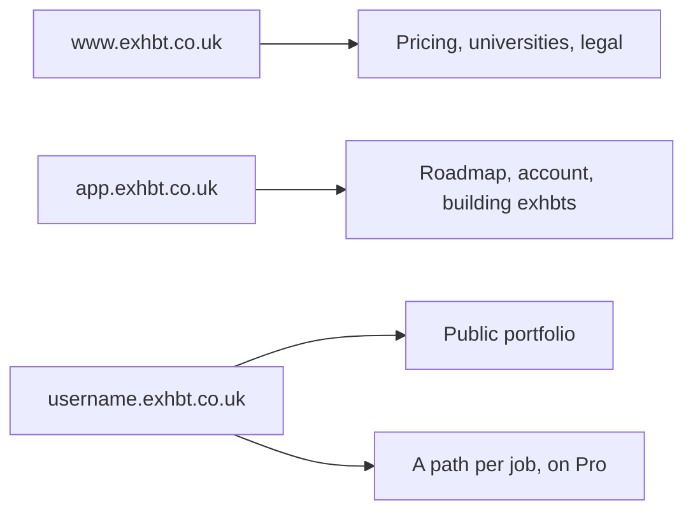

# Exhbt, as it stands

Read this first. Plan figures live only in `lib/entitlements.ts`. Hosts live only in `lib/hosts.ts`. If a sentence elsewhere disagrees with those files, the code is right and the sentence is stale. Decisions, including why the tiers and hosts look like this, are in `docs/decisions/`. How to run the app is `HANDOFF.md`. Visual rules are `DESIGN.md`.

`docs/PLAN.md` is the old plan from when the repo was still called Terna. Do not treat it as current. `design-references/` is other companies' visual notes, not this product.

## Hosts

Phase 1 still serves the marketing pages and the roadmap on one origin. The three hosts are decided and not routed yet. Employer links are a path on the person's host. Cookies for sign-in stay on the app host.

## Plans

Free, Plus, and Pro differ by how many exhbts someone can host, how many roadmap refreshes they get, whether drafting is included, whether a job gets its own link, and whether publishing runs an originality check. Universities buy Pro for their students. Employers are free. The public name Pro is the stored key `premium`. Counts and the checklist sentences come from `ENTITLEMENTS` and `planFeatures()`.

Plus and Pro are waitlist-only. They have no public price.

## What a person does

Organic visits start on the home page. Ads, social, and QR codes use `/start`. Both ask for the job, then the builder: the CV (skippable), where you are now with education and skills, email. The roadmap shows straight away. The order is the `STEPS` array in `app/(app)/roadmap/new/RoadmapWizard.tsx`.

The result is five screens, listed as `VIEWS` in `components/roadmap/RoadmapViews.tsx`. Gaps opens with a skill radar (you now against what the job asks for), and Projects ends with the same radar after the projects. The skill map and its rules are in `docs/decisions/0003-cv-step-and-skill-radar.md`; the after-projects rule is `lib/roadmap/skills.ts`.

An exhbt is title, outcome, methodology flow, key-result chart, skill boxes, the work, verification, reflection. The component is `components/exhbt/Exhbt.tsx`.

## Where to change something

| You want to change | Open |
|---|---|
| A plan's limits or its checklist | `lib/entitlements.ts`, then a new file in `docs/decisions/` if the decision changed |
| A hostname or the shape of a portfolio address | `lib/hosts.ts` |
| Copy on the pricing page | It reads `planFeatures()` and `PLAN_NAMES`. Don't type the figures again |
| How Phase 1 runs | `HANDOFF.md` |
| Colours, type, the exhbt's layout rules | `DESIGN.md` |
