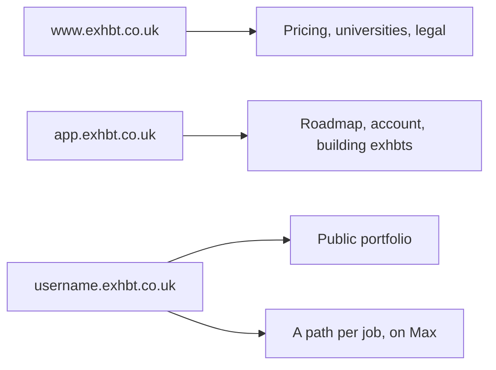

# Exhbt, as it stands

Read this first. Plan figures live only in `lib/entitlements.ts`. Hosts live only in `lib/hosts.ts`. If a sentence elsewhere disagrees with those files, the code is right and the sentence is stale. Decisions, including why the tiers and hosts look like this, are in `docs/decisions/`. How to run the app is `HANDOFF.md`. Visual rules are `DESIGN.md`.

`docs/PLAN.md` is the old plan from when the repo was still called Terna. Do not treat it as current. `design-references/` is other companies' visual notes, not this product.

## Hosts

Phase 1 still serves the marketing pages and the roadmap on one origin. The three hosts are decided and not routed yet. Employer links are a path on the person's host. Cookies for sign-in stay on the app host.

## Plans

Free, Premium and Max differ by how many exhbts someone can keep, whether they get a public portfolio, how many roadmap refreshes and AI drafts they get, file sizes, whether a job gets its own link, and whether publishing runs an originality check. Universities get Max for their students. Employers are free. The stored keys follow the names (`free`, `premium`, `max`, `institutional`; decision 0006). Counts, prices and the checklist sentences come from `ENTITLEMENTS`, `PRICES` and `planFeatures()` in `lib/entitlements.ts`.

On `main` (the live site) the paid plans are still waitlist-only. Payments arrive with Phase 2, below.

## What a person does

Organic visits start on the home page. Ads, social, and QR codes use `/start`. Both ask for the job, then the builder: the CV (skippable), and where you are now with education and skills. The roadmap shows straight away, with no email asked for yet. The order is the `STEPS` array in `app/(app)/roadmap/new/RoadmapWizard.tsx`.

The result is five screens, listed as `VIEWS` in `components/roadmap/RoadmapViews.tsx`: Overview, Gaps, Already strong, Projects, What next. Gaps opens with a skill radar (you now against what the job asks for). Projects is behind a gate that asks for a name, an email and optionally LinkedIn, prefilled from the CV. Behind it are three project ideas, each swappable, which become the plan, then the same radar after the projects. The gate and the plan are in `docs/decisions/0004-email-gate-and-plan.md`. The skill map and its rules are in `docs/decisions/0003-cv-step-and-skill-radar.md`; the after-projects rule is `lib/roadmap/skills.ts`.

An exhbt is title, outcome, methodology flow, key-result chart, skill boxes, the work, verification, reflection. The component is `components/exhbt/Exhbt.tsx`. Phase 2 replaces this layout with the block layout below; the demo portfolio still uses the old one.

## Phase 2 (on the `phase-2` branch)

Phase 2 is the paid product: build exhbts, publish them to a portfolio, pay for a plan. The plan is `docs/phase-2.md`. It lives on the `phase-2` branch and reaches `main` once, on launch day (`LAUNCH.md`). In production its pages also need the runtime setting `EXHBT_PHASE2=1` (`isPhase2Enabled()` in `lib/site.ts`); in development and tests it's always on.

**Plans and limits.** Every limit is read from `lib/entitlements.ts` and checked on the server: `getPlan()` in `lib/plan.ts` finds the plan (a live subscription, then a university licence, then Free), and `lib/plan-rules.ts` decides (can they start another exhbt, publish one, make a job link). After a downgrade nothing is deleted; the portfolio shows as many published exhbts as the new plan allows, in the person's order.

**The exhbt and its editor.** An exhbt is a fixed set of blocks (decision 0007). The schema, the limits and `wordCount()` are `lib/exhbt/blocks.ts`; the word cap counts everything on the page except image alt text (decision 0009). `components/portfolio/ProjectView.tsx` draws it. The editor is `/exhbts/[id]/edit` (`components/editor/`): cards with a small Tiptap field for each text, the flowchart edited on the diagram, live preview. Saving never blocks; publishing runs `validateForPublish()` again on the server. `exhbts.blocks` is the working copy and `published_blocks` what employers see, so a live page never shows a half-finished edit.

**Uploads and the AI draft.** `/exhbts/new`. The browser reads most files itself (`lib/doc-readers.ts`); scans and photos go to the AI only with consent (`/api/files/transcribe`). Files go straight from the browser to Supabase Storage with a signed upload URL (`lib/uploads.ts`), into two private buckets: `sources` for project material, `evidence` for images, evidence files and profile photos. Portfolio pages show them through links that expire after an hour (`lib/files.ts`). The draft is `lib/ai/exhbt-draft.ts`, called by `/api/exhbts/draft`; `lib/exhbt/verify.ts` flags any number it can't find in the material.

**Portfolio pages.** The route group `app/(portfolio)`. Profile fields (username, headline, bio, photo, "hide from search") are set at `/account/portfolio`. Which host serves what is decision 0001 and `lib/hosts.ts`; the subdomain routing is being built separately.

**Billing.** Stripe Checkout and the Billing Portal from `/account/billing`; `lib/stripe.ts`; the webhook at `/api/stripe/webhook` writes `subscriptions`. `/api/health` reports the Stripe settings and the Storage buckets under `phase2`, without affecting `ok`.

**Per-job links (Max).** In progress: the pages and the AI's picks are being built (`docs/phase-2.md` section 8, decision 0008). Until then the privacy policy calls job matching "coming soon".

**Roadmaps list and saved ideas.** `/roadmap` lists the person's roadmaps (`listRoadmapsFor`) and starts a new one for a different job from just the job, reusing the newest roadmap's details (`startRoadmapForJob` in `app/(app)/roadmap/actions.ts`, sharing `createRoadmapFor` in `lib/roadmap-create.ts` with the builder). Premium and Max can save a project idea to a list kept across roadmaps (`savedIdeas` in `lib/entitlements.ts`, page `/roadmap/saved`, table `saved_ideas`); a saved idea is a copy, so a swap never changes it. Decision 0010.

**Portfolio looks.** The band at the top of a portfolio comes in a fixed list of looks (colours, heading font, photo shape) in `lib/portfolio-themes.ts`. `portfolioThemes` in `lib/entitlements.ts` says how many of them a plan has; `themeFor(profile, plan)` picks the one to show and falls back to the default after a downgrade without clearing the saved choice. The picker is the "Look" section of `/account/portfolio`; the id is stored in `profiles.portfolio_theme`. Decision 0012.

**Privacy.** The account export (`/api/account/export`, `exportUserData` in `lib/store.ts`) includes the portfolio profile, every exhbt with both copies, file details (not the files), subscriptions and saved ideas. The privacy policy and terms are `app/(marketing)/legal/[doc]/page.tsx`.

## Where to change something

| You want to change | Open |
|---|---|
| A plan's limits or its checklist | `lib/entitlements.ts`, then a new file in `docs/decisions/` if the decision changed |
| A hostname or the shape of a portfolio address | `lib/hosts.ts` |
| Copy on the pricing page | It reads `planFeatures()` and `PLAN_NAMES`. Don't type the figures again |
| How Phase 1 runs | `HANDOFF.md` |
| Colours, type, the exhbt's layout rules | `DESIGN.md` |
| A plan's price, or which plan unlocks what | `lib/entitlements.ts`; the rules that read it are `lib/plan-rules.ts` |
| The exhbt's blocks, limits or word cap | `lib/exhbt/blocks.ts`, and decisions 0007 and 0009 |
| How an exhbt looks on a portfolio | `components/portfolio/ProjectView.tsx` |
| The editor | `app/(app)/exhbts/[id]/edit/`, `components/editor/` |
| The AI draft prompt, or the number check | `lib/ai/exhbt-draft.ts`, `lib/exhbt/verify.ts` |
| File types, size checks, buckets | `lib/uploads.ts`, `lib/files.ts` |
| Stripe checkout, portal, webhook | `app/(app)/account/billing/`, `lib/stripe.ts`, `app/api/stripe/webhook/route.ts` |
| Roadmaps list, saved ideas | `app/(app)/roadmap/page.tsx`, `app/(app)/roadmap/saved/`, `components/roadmap/SaveIdea.tsx`, decision 0010 |
| Portfolio looks: colours, fonts, which plan has which | `lib/portfolio-themes.ts`, `portfolioThemes` in `lib/entitlements.ts`, decision 0012 |
| What the account export includes | `exportUserData` in `lib/store.ts` (both implementations) |
| Privacy policy, terms, cookies | `app/(marketing)/legal/[doc]/page.tsx` |
