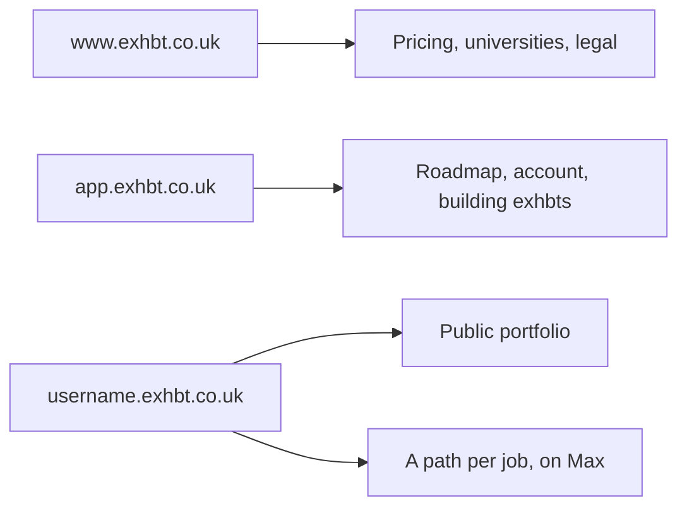

# Exhbt, as it stands

Read this first. Plan figures live only in `lib/entitlements.ts`. Hosts live only in `lib/hosts.ts`. If a sentence elsewhere disagrees with those files, the code is right and the sentence is stale. Decisions, including why the tiers and hosts look like this, are in `docs/decisions/`. How to run the app is `HANDOFF.md`. Visual rules are `DESIGN.md`.

`docs/PLAN.md` is the old plan from when the repo was still called Terna. Do not treat it as current. `design-references/` is other companies' visual notes, not this product.

## Hosts

The bare apex (exhbt.co.uk) redirects to www with a 308, keeping the path and query, because sign-in cookies are host-only (`canonicalRedirectUrl` in `lib/hosts.ts`, called first in `middleware.ts`). Register the Stripe webhook on www.

At launch, with `EXHBT_TOOL_HOST=1` set, www and the apex send /login, /roadmap and /auth to the app host (until then sign-in stays on www, and email links use the request host); a person's host is their portfolio. Localhost and a workers.dev preview stay one origin, so development is unchanged. Employer links are a path on the person's host. Cookies for sign-in stay on the app host. The Worker routes that attach those domains are not in `wrangler.jsonc` yet: a deploy cannot add them until exhbt.co.uk is a zone on this Cloudflare account.

## Plans

Free, Premium and Max differ by how many exhbts someone can keep, whether they get a public portfolio, how many roadmap refreshes and AI drafts they get, file sizes, whether a job gets its own link, and whether publishing runs an originality check. Universities get Max for their students. Employers are free. The stored keys follow the names (`free`, `premium`, `max`, `institutional`; decision 0006). Counts, prices and the checklist sentences come from `ENTITLEMENTS`, `PRICES` and `planFeatures()` in `lib/entitlements.ts`.

On `main` (the live site) the paid plans are still waitlist-only. Payments arrive with Phase 2, below.

## What a person does

Organic visits start on the home page. Ads, social, and QR codes use `/start`. Both ask for the job, then the builder: the CV (skippable), and where you are now with education and skills. The roadmap shows straight away, with no email asked for yet. The order is the `STEPS` array in `app/(app)/roadmap/new/RoadmapWizard.tsx`.

The result is five screens, listed as `VIEWS` in `components/roadmap/RoadmapViews.tsx`: Overview, Gaps, Already strong, Projects, What next. Gaps opens with a skill radar (you now against what the job asks for). Projects is behind a gate that asks for a name, an email and optionally LinkedIn, prefilled from the CV. Behind it are three project ideas, each swappable, which become the plan, then the same radar after the projects. The ideas are written in the background right after the roadmap, and the page shows progress, or a Try again, until they exist (`docs/decisions/0019-project-ideas-loading.md`). The gate and the plan are in `docs/decisions/0004-email-gate-and-plan.md`. The skill map and its rules are in `docs/decisions/0003-cv-step-and-skill-radar.md`; the after-projects rule is `lib/roadmap/skills.ts`.

An exhbt is title, outcome, methodology flow, key-result chart, skill boxes, the work, verification, reflection. The component is `components/exhbt/Exhbt.tsx`. Phase 2 replaces this layout with the block layout below; the demo portfolio still uses the old one.

## Phase 2 (on the `phase-2` branch)

Phase 2 is the paid product: build exhbts, publish them to a portfolio, pay for a plan. The plan is `docs/phase-2.md`. It lives on the `phase-2` branch and reaches `main` once, on launch day (`LAUNCH.md`). In production its pages also need the runtime setting `EXHBT_PHASE2=1` (`isPhase2Enabled()` in `lib/site.ts`); in development and tests it's always on.

**Plans and limits.** Every limit is read from `lib/entitlements.ts` and checked on the server: `getPlan()` in `lib/plan.ts` finds the plan (a live subscription, then a university licence, then Free), and `lib/plan-rules.ts` decides (can they start another exhbt, publish one, make a job link). After a downgrade nothing is deleted; the portfolio shows as many published exhbts as the new plan allows, in the person's order.

**The exhbt and its editor.** An exhbt has a fixed core: the header, the title (which is the question the work answers), a context line with its gap highlighted, and the process flowchart (decisions 0007 and 0022). Beside it, a sidebar holds the person, what the work is, where and when, the checks, the work and Save as PDF; the page's look comes from the portfolio's, through the `--xp-*` variables (decision 0022). Below the flowchart come sections the person adds, removes and puts in order: findings, graphs, images, a quote, what I'd do next and a link (decision 0015). The schema, the limits and `wordCount()` are `lib/exhbt/blocks.ts`; the word cap counts everything on the page except image alt text and link addresses (decision 0009). Docs saved before sections are read as sections, in their old order, by `normaliseDoc`, which the store runs on every read. `components/portfolio/ProjectView.tsx` draws it, with What I found beside a neighbouring graph or image. `exhbtSummary()` is the one sentence portfolio cards show (the summary, or the first finding). The editor is `/exhbts/[id]/edit` (`components/editor/`): cards with a small Tiptap field for each text, the flowchart edited on the diagram, sections dragged with dnd-kit or moved with buttons (`Sections.tsx`), live preview, where "Arrange sections" lets them be dragged too (`PreviewArrange.tsx`). Saving never blocks; publishing runs `validateForPublish()` again on the server. `exhbts.blocks` is the working copy and `published_blocks` what employers see, so a live page never shows a half-finished edit.

**Graphs.** Up to two per exhbt, each one of a fixed set of kinds (before and after, bars, grouped and stacked bars, line, scatter, big numbers, a small table), typed in by hand in the graph card, every value printed on the page. The kinds, their caps and checks are `lib/exhbt/charts.ts`; `components/charts/Chart.tsx` draws them for the project page and the editor's preview. A graph can protect its real numbers (shown as a change or an index); publishing then stores only the index, so the typed figures stay in the working copy. Decision 0011.

**Uploads and the AI draft.** `/exhbts/new`. The browser reads most files itself (`lib/doc-readers.ts`); scans and photos go to the AI only with consent (`/api/files/transcribe`). Files go straight from the browser to Supabase Storage with a signed upload URL (`lib/uploads.ts`), into two private buckets: `sources` for project material, `evidence` for images, evidence files and profile photos. Portfolio pages show them through links that expire after an hour (`lib/files.ts`). The draft is `lib/ai/exhbt-draft.ts`, called by `/api/exhbts/draft`; `lib/exhbt/verify.ts` flags any number it can't find in the material.

**Portfolio pages.** The route group `app/(portfolio)`. Profile fields (username, headline, bio, photo, "hide from search") are set at `/account/portfolio`. Which host serves what is decision 0001 and `lib/hosts.ts`; the subdomain routing is being built separately.

**Billing.** Stripe Checkout and the Billing Portal from `/account/billing`; `lib/stripe.ts`; the webhook at `/api/stripe/webhook` writes `subscriptions`. `/api/health` reports the Stripe settings and the Storage buckets under `phase2`, without affecting `ok`.

**Per-job links (Max).** In progress: the pages and the AI's picks are being built (`docs/phase-2.md` section 8, decision 0008). Until then the privacy policy calls job matching "coming soon".

**Roadmaps list and saved ideas.** `/roadmap` lists the person's roadmaps (`listRoadmapsFor`) and starts a new one for a different job from just the job, reusing the newest roadmap's details (`startRoadmapForJob` in `app/(app)/roadmap/actions.ts`, sharing `createRoadmapFor` in `lib/roadmap-create.ts` with the builder). Premium and Max can save a project idea to a list kept across roadmaps (`savedIdeas` in `lib/entitlements.ts`, page `/roadmap/saved`, table `saved_ideas`); a saved idea is a copy, so a swap never changes it. Decision 0010.

**Portfolio looks.** The band at the top of a portfolio comes in a fixed list of looks (colours, heading font, photo shape) in `lib/portfolio-themes.ts`. `portfolioThemes` in `lib/entitlements.ts` says how many of them a plan has; `themeFor(profile, plan)` picks the one to show and falls back to the default after a downgrade without clearing the saved choice. The picker is the "Look" section of `/account/portfolio`; the id is stored in `profiles.portfolio_theme`. Decision 0012.

**Portfolio customiser.** `/portfolio/customise` shows the person's glance page at full size, built from the same components as the public one. They drag tiles into order, hide or feature an exhbt, pick a look, switch the skills strip and LinkedIn button, and add extra tiles (About me, Education, Experience, a quote, Links and contact; `extraTiles` in `lib/entitlements.ts`). It autosaves with an undo. The layout is `profiles.portfolio_layout` (`lib/portfolio-layout.ts`); hidden and featured are `exhbts.hidden_on_portfolio` and `profiles.featured_exhbt_id`; project order stays `exhbts.position`. A hidden exhbt keeps its own link. Decision 0014.

**Teammates and identical files.** An exhbt's owner invites teammates by email from `/exhbts/[id]/team`; accepted ones show under the author on the project page and on the tile, and can make their own exhbt from the project with their own copies of its files (`team_of`). After every upload the server fingerprints the stored file (`/api/files/[id]/complete`); the same file on someone else's exhbt gets a private "Were you on that project together?" and never a public label. `lib/team.ts`, `lib/duplicates.ts`, decision 0013.

**Privacy.** The account export (`/api/account/export`, `exportUserData` in `lib/store.ts`) includes the portfolio profile, every exhbt with both copies, file details (not the files), subscriptions, saved ideas, team memberships and invites, and the person's own side of any file match. The privacy policy and terms are `app/(marketing)/legal/[doc]/page.tsx`.

## Where to change something

| You want to change | Open |
|---|---|
| A plan's limits or its checklist | `lib/entitlements.ts`, then a new file in `docs/decisions/` if the decision changed |
| A hostname or the shape of a portfolio address | `lib/hosts.ts` |
| Copy on the pricing page | It reads `planFeatures()` and `PLAN_NAMES`. Don't type the figures again |
| How Phase 1 runs | `HANDOFF.md` |
| Colours, type, the exhbt's layout rules | `DESIGN.md` |
| A plan's price, or which plan unlocks what | `lib/entitlements.ts`; the rules that read it are `lib/plan-rules.ts` |
| The exhbt's blocks, limits or word cap | `lib/exhbt/blocks.ts`, and decisions 0007, 0009 and 0015 |
| Which sections an exhbt can have below the flowchart, and how they're added, moved and drawn | `lib/exhbt/blocks.ts` (`SectionSchema`, `normaliseDoc`), `lib/exhbt/sections.ts`, `components/editor/Sections.tsx`, `components/portfolio/ProjectView.tsx`, decision 0015 |
| A kind of graph, its caps, how it's drawn, or protected numbers | `lib/exhbt/charts.ts`, `components/charts/`, the graph card `components/editor/ChartEditor.tsx`, decision 0011 |
| How an exhbt looks on a portfolio: the sidebar, the title as the question, findings beside the chart, print | `components/portfolio/ProjectView.tsx`, decision 0022 |
| How a portfolio look restyles the exhbt page | the `--xp-*` variables in `app/globals.css`, listed in decision 0022 |
| The editor | `app/(app)/exhbts/[id]/edit/`, `components/editor/` |
| The AI draft prompt, or the number check | `lib/ai/exhbt-draft.ts`, `lib/exhbt/verify.ts` |
| File types, size checks, buckets | `lib/uploads.ts`, `lib/files.ts` |
| Stripe checkout, portal, webhook | `app/(app)/account/billing/`, `lib/stripe.ts`, `app/api/stripe/webhook/route.ts` |
| How project ideas are started, shown while pending, retried; the stand-in's `EXHBT_MOCK_IDEAS_DELAY_MS` and `EXHBT_MOCK_IDEAS_FAIL_FIRST` | `lib/roadmap/ideas.ts`, `lib/ai/projects.ts`, `components/roadmap/IdeasPending.tsx`, decision 0019 |
| Roadmaps list, saved ideas | `app/(app)/roadmap/page.tsx`, `app/(app)/roadmap/saved/`, `components/roadmap/SaveIdea.tsx`, decision 0010 |
| Portfolio looks: colours, fonts, which plan has which | `lib/portfolio-themes.ts`, `portfolioThemes` in `lib/entitlements.ts`, decision 0012 |
| Teammates, invites, a teammate's own exhbt, matching identical files | `lib/team.ts`, `lib/team-rules.ts`, `lib/duplicates.ts`, `app/(app)/exhbts/[id]/team/`, decision 0013 |
| The customiser, the layout schema, extra tiles | `app/(app)/portfolio/customise/`, `lib/portfolio-layout.ts`, `components/portfolio/ExtraTiles.tsx`, decision 0014 |
| Referrals (off): the link, cookie, credit, the `REFERRALS_LIVE` switch, the credit figure | `lib/referrals.ts`, `app/r/[code]/route.ts`, `applyReferralsOnCheckout` in `app/api/stripe/webhook/route.ts`, `REFERRAL_CREDIT_PENCE` in `lib/entitlements.ts`, decision 0020 |
| The admin panel (team only, read-only), its role check, and the anonymous page-view beacon | `app/(app)/admin/`, `lib/admin.ts`, `lib/admin-supabase.ts`, the `/* admin */` block in `lib/store.ts`, `app/api/pv/route.ts`, `components/site/PageViewBeacon.tsx`, decision 0021 |
| What the account export includes | `exportUserData` in `lib/store.ts` (both implementations) |
| Privacy policy, terms, cookies | `app/(marketing)/legal/[doc]/page.tsx` |
