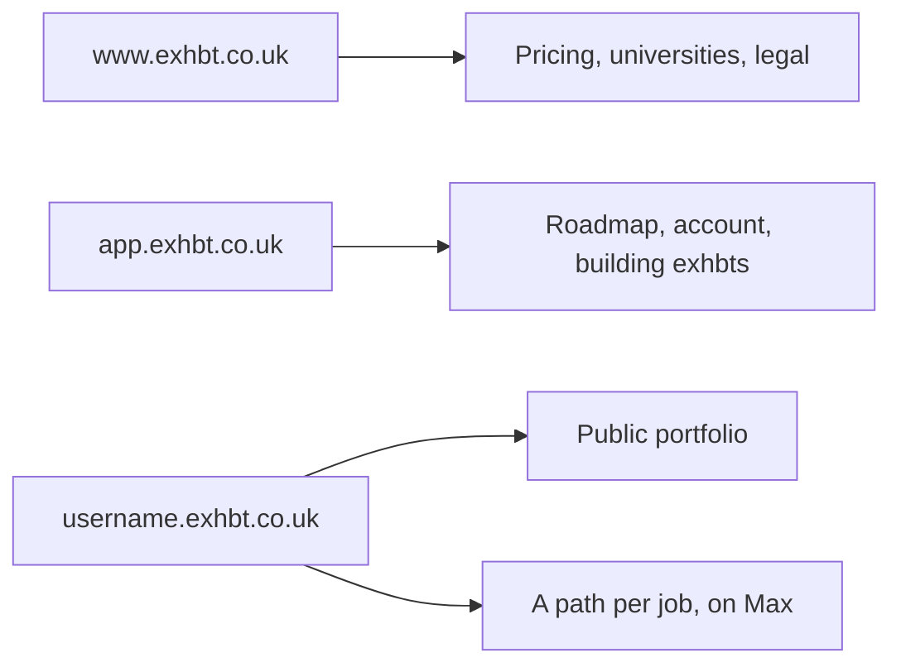

# Exhbt, as it stands

Read this first. Plan figures live only in `lib/entitlements.ts`. Hosts live only in `lib/hosts.ts`. If a sentence elsewhere disagrees with those files, the code is right and the sentence is stale. Decisions, including why the tiers and hosts look like this, are in `docs/decisions/`. How to run the app is `HANDOFF.md`. Visual rules are `DESIGN.md`.

`docs/PLAN.md` is the old plan from when the repo was still called Terna. Do not treat it as current. `design-references/` is other companies' visual notes, not this product.

## Hosts

The bare apex (exhbt.co.uk) redirects to www with a 308, keeping the path and query, because sign-in cookies are host-only (`canonicalRedirectUrl` in `lib/hosts.ts`, called first in `middleware.ts`). Register the Stripe webhook on www.

**Search engines and link previews.** `lib/seo.ts` is the one table of marketing pages (address, title, description, preview-image words) and builds each page's canonical, Open Graph and Twitter metadata and the JSON-LD (Organization and WebSite in the marketing layout, Person on a portfolio home, CreativeWork on an exhbt). `metadataBase` is set in `app/(marketing)/layout.tsx` only; portfolio pages give absolute addresses on the person's own host (`portfolioCanonical`). Marketing previews are `/og/<page>.png` (`app/(marketing)/og/[key]/route.tsx`, `marketingCard` in `lib/og/card.tsx`); portfolio previews are the `preview.png` routes. Each portfolio host serves its own `/sitemap.xml` and `/robots.txt` (`app/(portfolio)/p/[username]/`; the middleware matcher no longer skips robots.txt). Hidden-from-search portfolios, exhbts left off the home page, job links and owner previews are noindex and out of the sitemap. Rory's Search Console steps are in `LAUNCH.md`.

At launch, with `EXHBT_TOOL_HOST=1` set, www and the apex send sign-in, roadmaps, exhbts, the portfolio and the account to the app host (until then they stay on www, and email links use the request host); a person's host is their portfolio. Job links are a section of the portfolio page, not their own item in the header. Localhost and a workers.dev preview stay one origin, so development is unchanged. Employer links are a path on the person's host. Cookies for sign-in stay on the app host. The Worker routes that attach those domains are not in `wrangler.jsonc` yet: a deploy cannot add them until exhbt.co.uk is a zone on this Cloudflare account.

## Plans

Free, Premium and Max differ by how many exhbts someone can keep, whether they get a public portfolio, how many roadmap refreshes and AI drafts they get, file sizes, whether a job gets its own link, and whether publishing runs an originality check. Universities get Max for their students. Employers are free. The stored keys follow the names (`free`, `premium`, `max`, `institutional`; decision 0006). Counts, prices and the checklist sentences come from `ENTITLEMENTS`, `PRICES` and `planFeatures()` in `lib/entitlements.ts`.

On `main` (the live site) the paid plans are still waitlist-only. Payments arrive with Phase 2, below.

## What a person does

Organic visits start on the home page. Ads, social, and QR codes use `/start`. Both ask for the job, then the builder: the CV (skippable), and where you are now with education and skills. The roadmap shows straight away, with no email asked for yet. The order is the `STEPS` array in `app/(app)/roadmap/new/RoadmapWizard.tsx`.

The result is five screens, listed as `VIEWS` in `components/roadmap/RoadmapViews.tsx`: Overview, Gaps, Already strong, Projects, What next. Gaps opens with the one skill radar: the job's levels always, and you, switchable between Now and After the projects (the switch needs the plan's ideas, so it shows after the gate). Projects is behind a gate that asks for a name, an email and optionally LinkedIn, prefilled from the CV. Behind it are three project ideas, each swappable, which become the plan, with a link back to the radar. The ideas are written in the background right after the roadmap, and the page shows progress, or a Try again, until they exist (`docs/decisions/0019-project-ideas-loading.md`). The gate and the plan are in `docs/decisions/0004-email-gate-and-plan.md`. The skill map is in `docs/decisions/0003-cv-step-and-skill-radar.md`; the radar's one-chart design, level anchors and after-projects rule are in `docs/decisions/0023-skill-radar.md` (`lib/roadmap/skills.ts`, `lib/roadmap/radar.ts`).

An exhbt is title, outcome, methodology flow, key-result chart, skill boxes, the work, verification, reflection. The component is `components/exhbt/Exhbt.tsx`. Phase 2 replaces this layout with the block layout below; the demo portfolio, Home and the what-is page already show the new one, and the employer guide (`/how-to-read-an-exhbt`) still shows the old card.

## Phase 2 (on the `phase-2` branch)

Phase 2 is the paid product: build exhbts, publish them to a portfolio, pay for a plan. The plan is `docs/phase-2.md`. It lives on the `phase-2` branch and reaches `main` once, on launch day (`LAUNCH.md`). In production its pages also need the runtime setting `EXHBT_PHASE2=1` (`isPhase2Enabled()` in `lib/site.ts`); in development and tests it's always on.

**Plans and limits.** Every limit is read from `lib/entitlements.ts` and checked on the server: `getPlan()` in `lib/plan.ts` finds the plan (a live subscription, then a university licence, then Free), and `lib/plan-rules.ts` decides (can they start another exhbt, publish one, make a job link). After a downgrade nothing is deleted; the portfolio shows as many published exhbts as the new plan allows, in the person's order.

**The exhbt and its editor.** An exhbt has a fixed core: the header, the title (which is the question the work answers), a context line with its gap highlighted, and the process flowchart (decisions 0007 and 0022). Beside it, a sidebar holds the person, what the work is, where and when, the checks, the work and Save as PDF; the page's look comes from the portfolio's, through the `--xp-*` variables (decision 0022). Around the flowchart come sections the person adds, removes and puts in order: findings, graphs, images, a quote, what I'd do next and a link (decision 0015). The flowchart's place among them is a marker in `sections` (its boxes stay in `flow`), so it can move, and in the layouts that allow it be taken off the page (`flowOff`, decision 0027); a doc with no marker is drawn as it always was (`adopt`), and the published copy keeps the marker. The schema, the limits and `wordCount()` are `lib/exhbt/blocks.ts`; the word cap counts everything on the page except image alt text and link addresses (decision 0009), and it is the only word limit: no part has one of its own, though the AI is asked to keep each short (`draftTargets` in `lib/ai/draft-targets.ts`, decision 0030). Docs saved before sections are read as sections, in their old order, by `normaliseDoc`, which the store runs on every read. One engine, `lib/exhbt/layouts.ts`, works out what the main column draws and in which rows, for every layout, from per-layout rules (`pageItems`, `rowsFor`, `ROW_RULES`; decision 0027), and `components/portfolio/ProjectView.tsx` draws the page. An exhbt also has a layout, `format`: a case study (the default), a gallery for visual work or research for experiments, kept in the same doc and read by `lib/exhbt/formats.ts` (decision 0024). Four more (build, essay, before and after, event or performance; decision 0028) make seven. The new editor offers all seven (`OFFERED_FORMATS`), and for a person whose editor it is the AI draft chooses among them, by 0028's rules in its order (`lib/ai/exhbt-draft.ts`); what a draft keeps for the new parts (a pull quote, a source, a role, a build's links) is only what the material holds (`toDoc` in `lib/ai/draft-answer.ts`). The classic editor can't edit what the four add, so it offers the first three (`CLASSIC_FORMATS`), a person whose editor it is gets drafted among those three, and the server refuses the other four for them unless the exhbt already has that layout (`layoutAllowed`). `exhbtSummary()` is the one sentence portfolio cards show (the summary, or the first finding). The editor is `/exhbts/[id]/edit`, and it is the page itself (decision 0026, `components/exhbt-editor/`): `ProjectView` draws the exhbt in the person's own look with the editor's slots (`components/portfolio/page-ctx.ts`), and every word is typed where it sits. The doc is held in a store outside React, and each section is a frame that reads only its own slice, so typing re-renders one section (`store.ts`, `Frame.tsx`). Undo reverses actions rather than restoring a snapshot, so typing done since is kept (`undo.ts`). A stored file is deleted only by 0026's four-part rule (`files.ts`). The new editor loads only in the browser, behind a crash fallback that sends the newest doc and reloads into the classic editor (`EditorGate.tsx`, `pending.ts`). The classic editor (`components/editor/`, cards beside a live preview) is what everyone gets until the new one is switched on: `DEFAULT_EDITOR` in `lib/editor-kind.ts` says which, the runtime variable `EXHBT_EDITOR` overrides it for everyone with no deploy (`page` or `classic`), and an admin can choose either editor for themselves (decision 0026, "Going live: switched off, then on"). After that it stays for one release, behind `?editor=classic`. Saving never blocks; publishing runs `validateForPublish()` again on the server. `exhbts.blocks` is the working copy and `published_blocks` what employers see, so a live page never shows a half-finished edit.

**Graphs.** Up to two per exhbt, each one of a fixed set of kinds (before and after, bars, grouped and stacked bars, line, scatter, big numbers, a small table), typed in by hand in the graph card, every value printed on the page. The kinds, their caps and checks are `lib/exhbt/charts.ts`; `components/charts/Chart.tsx` draws them for the project page and the editor's preview. A graph can protect its real numbers (shown as a change or an index); publishing then stores only the index, so the typed figures stay in the working copy. Decision 0011.

**Adding an exhbt.** `/exhbts/new` is a chooser with two ways to start, of equal weight (`app/(app)/exhbts/new/`; the addresses are `lib/add-exhbt.ts`). "Draft it from my files" opens the upload form below, at `?start=draft`. "Write it myself" opens the layouts the person's editor offers, at `?start=blank`, each with the sketch and the line the editor's layout menu draws; pressing one makes an empty exhbt in that layout and opens the editor (`createFromScratch`, which refuses a layout that editor doesn't offer and sends a form that names none here to choose one). An address that already says what is being drafted skips the chooser: `?start=draft`, and `?into=<id>` for a teammate's own exhbt. A roadmap idea's "Build this as an exhbt" never comes here: it makes the prefilled exhbt and opens the editor. With the plan full the page shows the upgrade offer; with no AI drafts left the first way says why and the second still works. The page also says what an exhbt is (the sentence in `lib/exhbt/what-it-is.ts`, which `/what-is-an-exhbt` opens with) and where it ends up (the publish step's own sentence, `WhereItGoes`), beside the demo's first exhbt as a picture. It is the first screen built from Astryx components (`DESIGN.md`, "Design system"): each card has one real link or submit button whose press area covers the card, so it works without the page's scripts.

**Uploads and the AI draft.** `/exhbts/new?start=draft`, the chooser's first way. The browser reads most files itself (`lib/doc-readers.ts`, a PowerPoint file's slides with their speaker notes among them); scans and photos go to the AI only with consent (`/api/files/transcribe`). Files go straight from the browser to Supabase Storage with a signed upload URL (`lib/uploads.ts`), into two private buckets: `sources` for project material, `evidence` for images, evidence files and profile photos. Portfolio pages show them through links that expire after an hour (`lib/files.ts`). The draft is `lib/ai/exhbt-draft.ts`, called by `/api/exhbts/draft`; `lib/exhbt/verify.ts` flags any number it can't find in the material. A draft or a rewrite reads files, notes and link up to one budget together (`MAX_MATERIAL_CHARS` in `lib/material.ts`, which says why that figure): each file is read whole on the device, a file too long for its share keeps its start and its end with the gap marked, and the page says on each file whether all of it was read. The draft and the rewrite may mark a key result in bold, or a term in italics, inside a finding, what I'd do next, the aim or the conclusion; `lib/exhbt/emphasis.ts` turns the marks into runs within its rules and takes them out of every other field, so every check reads the plain words (decision 0029, "Emphasis inside the answer"). Beside the draft, the pages of a PDF that draw a chart, diagram or picture, the pictures inside a Word or PowerPoint file (logos and tiny ones left out), and the PNG or JPEG files the person chose to send go to the AI to pick the one visual that best shows the result, and to say what it is: a graph, a results table or another visual. A scan's pages go only once the person has agreed to send the scan. A Word or PowerPoint file is read as a hostile zip (`lib/figures/office.ts`), and a chart drawn in Word or PowerPoint itself can't be lifted: the editor says to save the file as a PDF. The pick is cut out in the browser and placed where the layout wants its key figure, and publishing waits until the person ticks that they may share it. They can crop a PDF page's figure again, choose another page or remove it (decision 0017). The work's own graph wins: a picked graph or table removes the graph the draft drew, another visual sits beside it (in research, straight after the drafted graph, which stays the key figure), and with no pick the drafted graph stays (`withWorkVisual` in `lib/exhbt/sections.ts`). Each layout says what it takes from the work (`fromWork` in `lib/exhbt/formats.ts`): a case study, research and a build one figure; a gallery, a before and after and an event the person's uploaded pictures too, the lead first, up to the layout's cap on images; an essay nothing. When the editor opens it says once which layout was chosen and why, from a fixed list of reasons, and where the figure came from or that none was found (`lib/exhbt/drafted.ts`). Decision 0025. How well the real model picks and crops is measured by the figure eval (`evals/figure-pick/`, `npm run eval:figures`).

**Portfolio pages.** The route group `app/(portfolio)`. The home page is Rory's layout (`docs/design/portfolio-and-exhbt-layouts.pdf`, page 1; `components/portfolio/PortfolioHome.tsx`): a top bar and hero (photo, "Hi, I'm", the name, the intro), then sections the person adds and drags into order: their best piece of work in a band, more of their work as cards, About me with education and tools, experience, a quote, Get in touch. Every colour and corner is a CSS variable set by the look (decision 0016). The tab shows their name first and their initials as its icon (`initials.svg`). An owner with nothing live sees a preview at their own address; visitors get not found. A project page sits in the frame of `p/[username]/[slug]/layout.tsx`. Which host serves what is decision 0001 and `lib/hosts.ts`; the subdomain routing is being built separately.

**Billing.** Stripe Checkout and the Billing Portal from `/account/billing`; `lib/stripe.ts`; the webhook at `/api/stripe/webhook` writes `subscriptions`. `/api/health` reports the Stripe settings and the Storage buckets under `phase2`, without affecting `ok`.

**Per-job links (Max).** The list is a section of the portfolio page (`JobLinksSection` in `app/(app)/portfolio/`). `/job-links` redirects there. Making and editing one stays at `/job-links/new` and `/job-links/[id]` (`docs/phase-2.md` section 8, decision 0008): paste a job description or a link, the AI picks the best exhbts with a reason each, the person reorders, swaps, chooses the address and can switch it off. The public page is connected: `p/[username]/[slug]/page.tsx` checks for a job link first (`jobLinkFor` in `lib/job-link-request.ts`, which counts the view once per request), so `amara.exhbt.co.uk/lloyds` shows `components/portfolio/JobLinkView.tsx`: the person, "For <Company> · <Role>", their intro, and the picked exhbts as the portfolio home's own cards (`ProjectCard`) with the reason under each, in the person's look. The project frame (`[slug]/layout.tsx`) steps aside for it. A link that is off, deleted, on a plan without job links, or with none of its exhbts live is not found; the page is never indexed. A project opened with `?for=<slug>` shows "Back to <company>" while that link is live and picks it (`jobLinkBackTarget`). An exhbt and a job link share one slug space per person (`lib/slugs.ts`), so they cannot collide. The owner's preview is `/job-links/[id]/preview`. `JOB_LINKS_LIVE` in `lib/entitlements.ts` switches the "coming soon" wording off.

**Roadmaps list and saved ideas.** `/roadmap` lists the person's roadmaps (`listRoadmapsFor`) and starts a new one for a different job from just the job, reusing the newest roadmap's details (`startRoadmapForJob` in `app/(app)/roadmap/actions.ts`, sharing `createRoadmapFor` in `lib/roadmap-create.ts` with the builder). Premium and Max can save a project idea to a list kept across roadmaps (`savedIdeas` in `lib/entitlements.ts`, page `/roadmap/saved`, table `saved_ideas`); a saved idea is a copy, so a swap never changes it. Decision 0010.

**Portfolio looks.** Eight looks from Rory's spec (Exhbt, Classic professional, Notebook, Mono, Night, Studio, Ledger, Bloom; some with colourways) in `lib/portfolio-themes.ts`. A look sets the colours, faces, corners, graph shades and layout treatments of the whole portfolio: the home page, every exhbt page, the pager, the sign-off and per-job pages, through one set of `--pf-*` variables (`themeStyle` in `components/portfolio/themeFonts.ts`; the exhbt page's `--xp-*` names read it). `portfolioThemes` in `lib/entitlements.ts` says how many of them a plan has; `themeFor(profile, plan)` picks the one to show and falls back to the default after a downgrade without clearing the saved choice; ids saved before the eight map to the nearest (`LEGACY_IDS`). The picker is the builder's "Your look" step; the id is stored in `profiles.portfolio_theme`. Decision 0018.

**Portfolio builder.** `/portfolio` is one guided flow in four steps (You, Your look, Your projects, Publish) with a live preview of the whole page and autosave with an undo (`app/(app)/portfolio/`, decision 0016). The You step holds the profile fields (`lib/portfolio-profile.ts`) and "Suggest an intro" (`lib/ai/portfolio-intro.ts`, facts the person gave only). The Your page step orders, stars and hides the exhbts and adds the home page's sections and their words; the sections are dragged into order in the live preview (experience and a quote need `extraTiles` in `lib/entitlements.ts`). Publish holds the address, which only paid plans can claim (`canClaimUsername` in `lib/plan-rules.ts`). `/account/portfolio` and `/portfolio/customise` redirect into it. The layout is `profiles.portfolio_layout` (`lib/portfolio-layout.ts`); hidden and featured are `exhbts.hidden_on_portfolio` and `profiles.featured_exhbt_id`; project order stays `exhbts.position`. A hidden exhbt keeps its own link. Decision 0014.

**Teammates and identical files.** An exhbt's owner invites teammates by email from `/exhbts/[id]/team`; accepted ones show under the author on the project page and on the tile, and can make their own exhbt from the project with their own copies of its files (`team_of`). After every upload the server fingerprints the stored file (`/api/files/[id]/complete`); the same file on someone else's exhbt gets a private "Were you on that project together?" and never a public label. `lib/team.ts`, `lib/duplicates.ts`, decision 0013.

**Privacy.** The account export (`/api/account/export`, `exportUserData` in `lib/store.ts`) includes the portfolio profile, every exhbt with both copies, file details (not the files), subscriptions, saved ideas, team memberships and invites, and the person's own side of any file match. The privacy policy and terms are `app/(marketing)/legal/[doc]/page.tsx`.

## Where to change something

| You want to change | Open |
|---|---|
| A plan's limits or its checklist | `lib/entitlements.ts`, then a new file in `docs/decisions/` if the decision changed |
| A hostname or the shape of a portfolio address | `lib/hosts.ts` |
| Copy on the pricing page | It reads `planFeatures()` and `PLAN_NAMES`. Don't type the figures again |
| How Phase 1 runs | `HANDOFF.md` |
| Colours, type, the exhbt's layout rules | `DESIGN.md` |
| A plan's price, or which plan unlocks what | `lib/entitlements.ts`; the rules that read it are `lib/plan-rules.ts` |
| The exhbt's blocks, limits or word cap | `lib/exhbt/blocks.ts`, and decisions 0007, 0009, 0015 and 0030 |
| How many words the AI writes in each part (people have no cap on a part, only the page) | `lib/ai/draft-targets.ts`, decision 0030 |
| Which sections an exhbt can have below the flowchart, and how they're added, moved and drawn | `lib/exhbt/blocks.ts` (`SectionSchema`, `normaliseDoc`), `lib/exhbt/sections.ts`, `components/editor/Sections.tsx`, `components/portfolio/ProjectView.tsx`, decision 0015 |
| A kind of graph, its caps, how it's drawn, or protected numbers | `lib/exhbt/charts.ts`, `components/charts/`, the graph card `components/editor/ChartEditor.tsx`, decision 0011 |
| An exhbt's layout (seven: case study, gallery, research, build, essay, before and after, event or performance) | `lib/exhbt/formats.ts` (which are offered, and to whom), `lib/exhbt/layouts.ts` (the order and rows), `components/portfolio/LayoutMain.tsx` with `layout-rows.ts` (the renderer), `components/exhbt-editor/topbar/LayoutMenu.tsx` (the new editor's menu: seven), `components/editor/LayoutPicker.tsx` (the classic editor's: three), decisions 0024 and 0028 |
| How an exhbt looks on a portfolio: the sidebar, the title as the question, findings beside the chart, print | `components/portfolio/ProjectView.tsx`, decision 0022 |
| How a portfolio look restyles the exhbt page | the look's `--pf-*` set (decision 0018), read as the `--xp-*` names in `app/globals.css` (`[data-look]`, listed in decision 0022); the frame `app/(portfolio)/p/[username]/[slug]/layout.tsx` |
| "Add an exhbt": the two ways to start, the layouts to start an empty exhbt in, the addresses that skip the chooser | `app/(app)/exhbts/new/` (`page.tsx`, `Chooser.tsx`, `LayoutGallery.tsx`, `art.tsx`, `add-exhbt.css`), `lib/add-exhbt.ts`, `createFromScratch` in `app/(app)/exhbts/[id]/actions.ts`, `e2e/add-exhbt.spec.ts` |
| The editor | `app/(app)/exhbts/[id]/edit/`, `components/exhbt-editor/` (the page itself, decision 0026; `css/` holds each owner's styles), `components/editor/` (the classic editor, for one release) |
| Which editor a person gets | `lib/editor-kind.ts` (the rule and `DEFAULT_EDITOR`), `lib/editor-kind-server.ts`, `app/api/exhbts/editor/route.ts` (an admin's own choice) |
| The AI draft prompt, or the number check | `lib/ai/exhbt-draft.ts`, `lib/exhbt/verify.ts` (`misquoted` is the source-quote check the draft, the rewrite and the eval share) |
| What the AI may mark in bold and italics, and how its marks become runs | `lib/exhbt/emphasis.ts`, `emphasisRules` in `lib/ai/exhbt-draft.ts`, decision 0029 ("Emphasis inside the answer") |
| How an AI answer is read and repaired, and how a failed call is named, recorded, shown to the team and limited | `structuredCall` in `lib/ai/call.ts`, `lib/ai/repair.ts` and `repairDraft` in `lib/ai/draft-answer.ts`, `lib/ai/failure.ts` (the reasons, and `neverAnswered`), `lib/ai-failures.ts`, the "Failed AI calls" panel in `app/(app)/admin/page.tsx`, decision 0029 |
| The figure picked from an upload: which pages are sent, the pick prompt, the cut-out, the share tick, cropping and swapping pages | `lib/figures/` (`office.ts` reads the pictures in a Word or PowerPoint file as a hostile zip), `lib/ai/figure-pick.ts`, `/api/exhbts/figure-pick`, `/api/exhbts/[id]/figure`, `app/(app)/exhbts/new/figure.ts`, `components/editor/PickedFigure.tsx`, decisions 0017 and 0025 |
| Whether a picked visual replaces the drafted graph, and what each layout takes from the work | `withWorkVisual` in `lib/exhbt/sections.ts`, `fromWork` in `lib/exhbt/formats.ts`, `FIGURE_KINDS` in `lib/exhbt/blocks.ts`, decision 0025 |
| What the editor says once after a draft: the layout, why, and the figure | `lib/exhbt/drafted.ts`, `components/editor/LayoutPicker.tsx`, `formatReason` in `lib/ai/exhbt-draft.ts`, decision 0025 |
| The figure eval: the reports, the marking, how to run it with the real model | `evals/figure-pick/` (start with its README), `scripts/eval-figures.ts`, `app/dev/figure-eval/`, the `figures` job in `.github/workflows/eval-drafts.yml` |
| File types, size checks, buckets | `lib/uploads.ts`, `lib/files.ts` |
| Stripe checkout, portal, webhook | `app/(app)/account/billing/`, `lib/stripe.ts`, `app/api/stripe/webhook/route.ts` |
| How project ideas are started, shown while pending, retried; the stand-in's `EXHBT_MOCK_IDEAS_DELAY_MS` and `EXHBT_MOCK_IDEAS_FAIL_FIRST` | `lib/roadmap/ideas.ts`, `lib/ai/projects.ts`, `components/roadmap/IdeasPending.tsx`, decision 0019 |
| Roadmaps list, saved ideas | `app/(app)/roadmap/page.tsx`, `app/(app)/roadmap/saved/`, `components/roadmap/SaveIdea.tsx`, decision 0010 |
| Portfolio looks: colours, fonts, treatments, graph shades, old ids, which plan has which | `lib/portfolio-themes.ts`, `components/portfolio/themeFonts.ts` (variables and font loading), `portfolioThemes` in `lib/entitlements.ts`, decision 0018 |
| Teammates, invites, a teammate's own exhbt, matching identical files | `lib/team.ts`, `lib/team-rules.ts`, `lib/duplicates.ts`, `app/(app)/exhbts/[id]/team/`, decision 0013 |
| The portfolio builder, the layout schema, extra tiles | `app/(app)/portfolio/`, `lib/portfolio-layout.ts`, `components/portfolio/ExtraTiles.tsx`, decisions 0014 and 0016 |
| The portfolio home, its sections and what a card shows, the look's page variables, the profile fields, "Suggest an intro" | `components/portfolio/PortfolioHome.tsx`, `lib/portfolio-home.ts`, `lib/portfolio-layout.ts` (`sectionsOf`), `themeStyle` in `components/portfolio/themeFonts.ts`, `lib/portfolio-profile.ts`, `lib/ai/portfolio-intro.ts`, decisions 0016 and 0018 |
| Referrals (off): the link, cookie, credit, the `REFERRALS_LIVE` switch, the credit figure | `lib/referrals.ts`, `app/r/[code]/route.ts`, `applyReferralsOnCheckout` in `app/api/stripe/webhook/route.ts`, `REFERRAL_CREDIT_PENCE` in `lib/entitlements.ts`, decision 0020 |
| The admin panel (team only, read-only), its role check, and the anonymous page-view beacon | `app/(app)/admin/`, `lib/admin.ts`, `lib/admin-supabase.ts`, the `/* admin */` block in `lib/store.ts`, `app/api/pv/route.ts`, `components/site/PageViewBeacon.tsx`, decision 0021 |
| What the account export includes | `exportUserData` in `lib/store.ts` (both implementations) |
| Privacy policy, terms, cookies | `app/(marketing)/legal/[doc]/page.tsx` |
| A marketing page's title, description or link-preview image, canonical addresses, JSON-LD, sitemaps, robots.txt | `lib/seo.ts`, `lib/og/card.tsx`, `app/(marketing)/og/[key]/route.tsx`, `app/sitemap.ts`, `app/robots.ts`, `app/(portfolio)/p/[username]/sitemap.xml/route.ts` and `robots.txt/route.ts`, `e2e/seo.spec.ts` |
| When a legal page last changed (printed on the page, and the sitemap's lastmod) | `lib/legal.ts` |
